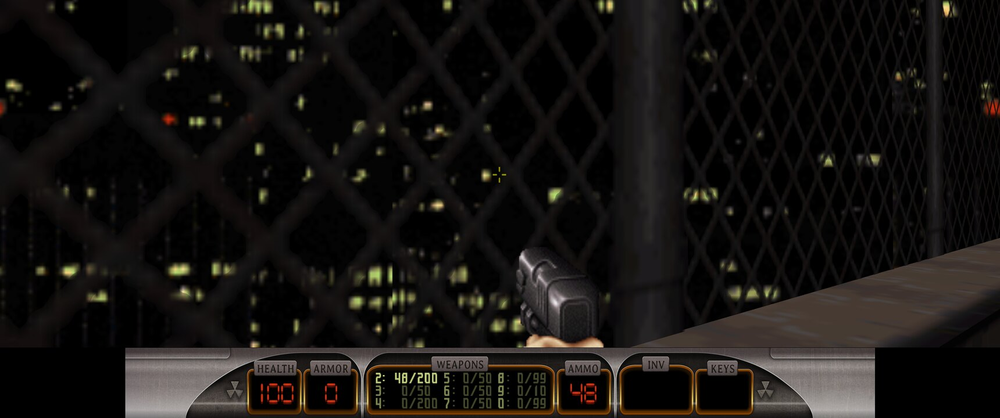

# Duke Nukem 3D: Megaton Edition - Ultrawide Fix

<p align="center">
  
</p>

Lets the now discontinued [Duke Nukem 3D: Megaton Edition](https://www.pcgamingwiki.com/wiki/Duke_Nukem_3D:_Megaton_Edition) (Steam) run at resolutions wider than 2560 pixels, such as 3440x1440. It works with the native Linux build and with the Windows build, on Windows or on Linux through Proton. macOS version is not supported but it does not work on macOS Catalina (10.15) or later anyways due to being 32-bit.

The main issue is that the engine sizes its per-column drawing buffers for screens only up to 2560 pixels wide, wider screens overrun them. This fix moves those buffers to new memory with room for 8192 columns and then raises the width limit. The details are in [docs/how-it-works.md](docs/how-it-works.md), and the tested resolutions and the test tools in [docs/testing.md](docs/testing.md).

This is an unofficial fix. It changes the game executable you already have, keeps a backup of the original and can be undone by either restoring the backup or verifying integrity of game files.

**NOTE:** Ultrawide here means ultrawide screens up to 1600 pixels tall, such as 3440x1440 or 3840x1600. Taller ultrawide modes such as 5120x2160 aren't covered and will still break, there are no plans to cover them for now.

---

## Requirements

- Duke Nukem 3D: Megaton Edition from Steam (Steam app 225140, build 610450), either the native Linux version or the Windows version.
- On Linux: a 64-bit desktop with glibc 2.28 or newer, which covers Ubuntu 20.04, Debian 10, Fedora 29, SteamOS 3 and anything newer. On Wayland the installer window runs through XWayland. If you play the Windows version through Proton, use the Linux installer. It finds `bin/duke3d.exe` in the same game folder.
- On Windows: 64-bit Windows 10 or 11.
- No root access. On Windows the installer asks for no administrator rights.

The fix works with these executables:

Linux:
| file | checksum |
| --- | --- |
| original `bin/duke3d` sha256 | `3caf660ad2df2e55fbaf60b9fca6afa6e1f5e17e402c37b39a6579bcc67c68db` |
| patched `bin/duke3d` sha256 | `0f3a86db7084036a28043cfd37d6bdf2c36cbd7cee4292e65990196ee1df66c2` |

Windows:
| file | checksum |
| --- | --- |
| original `bin/duke3d.exe` sha256 | `0782cf3803b847f55ec06c031eb6046c0f9edd1b49b31db30673254b99704d45` |
| patched `bin/duke3d.exe` sha256 | `6feb94dbb140bbc57a371da42979dc4ef0bb6e1b2d89ff3a88bfb11a64045d0a` |

Any failure is most likely because you are using an **unsupported older version.** The fix is to update the game on Steam.  The 20th Anniversary World Tour edition is not supported.


## Install

The installers are on the [releases page](https://github.com/larsoyd/duke3d-megaton-ultrawide-fix/releases). The game must not be running when doing this operation.

### Windows

Download `DukeNukem3D-Megaton-UltrawideFix-1.1.1.exe` and run it. The installer isn't signed, so Windows may show a "Windows protected your PC" box. Choose More info, then Run anyway.

### Linux

Download `DukeNukem3D-Megaton-UltrawideFix-1.1.1.tar.gz`, extract it and double-click the installer inside.

The release also has the installer as a bare `.run` file. A downloaded file is never marked as a program, so mark it first in your file manager (Properties > Permissions) or run:

```sh
chmod +x DukeNukem3D-Megaton-UltrawideFix-1.1.1.run
./DukeNukem3D-Megaton-UltrawideFix-1.1.1.run
```

### What the installer does

It asks for two things:

- The game folder. It fills this in when the game is in the default Steam library, otherwise use Browse.
- The resolution. It fills this in from your main screen. The game then starts at that size without a trip to the video menu. Leave it empty to keep the game's own setting.

It installs a small helper and an uninstaller in `~/.local/share/duke3d-megaton-ultrawide-fix` on Linux, or `%LOCALAPPDATA%\duke3d-megaton-ultrawide-fix` on Windows, then patches the game:

1. Checks the checksum of `bin/duke3d` or `bin/duke3d.exe`. It stops if the file is a version it doesn't know.
2. Copies the original to `bin/duke3d.megaton-original` or `bin/duke3d.exe.megaton-original` and checks the copy.
3. Builds the patched file next to the game, checks its checksum and moves it into place.
4. Writes the resolution to `gameroot/duke3d-local.cfg` and keeps the previous values.

## Uninstall

On Linux, run `~/.local/share/duke3d-megaton-ultrawide-fix/uninstall-ultrawide-fix` and choose to remove everything. On Windows, remove "Duke Nukem 3D Megaton Ultrawide Fix" in Settings > Apps > Installed apps, or run `uninstall-ultrawide-fix.exe` in its folder.

It puts the original game file and your previous screen settings back. If the backup is gone, Steam can restore the original with Properties > Installed Files > Verify integrity of game files.


## Steam updates 

Highly unlikely as Megaton Edition has been off sale since 2016 and its build hasn't changed since. But if Steam updates the game and you update or verify the game files, the original executable comes back and that new updated executable would not be supported until an update of the fix. But again, unlikely.

## Troubleshooting

- `refused: unknown executable`: the game is a different build, or something else has changed it. Verify the game files in Steam and try again.
- `refused: game not found`: add `--game-dir` with the folder that contains `bin/duke3d` or `bin/duke3d.exe`.
- `refused: backup ... is not the original`: there is already a different file called `duke3d.megaton-original` or `duke3d.exe.megaton-original`. Move it somewhere else and run the installer again.
- Access denied on Windows: the game is still running, or something else has the game file open. Quit it and run the installer again.
- `xdelta3 is not installed` from `install.sh`: install the `xdelta3` package, or use the graphical installer.
- The installer doesn't start and mentions a missing `libxcb` or `libxkbcommon` library: install your distribution's Qt or X11 runtime packages, or use `install.sh`.
- The game starts at the wrong resolution: it saves video settings when you quit through its menu. Closing the window another way loses them.

## Without the graphical installer (Linux only)

If the installer gives you grief, you can try the same fix as shell script, which need `xdelta3` (Arch: `pacman -S xdelta3`, Debian or Ubuntu: `apt install xdelta3`):

```sh
git clone https://github.com/larsoyd/duke3d-megaton-ultrawide-fix
cd duke3d-megaton-ultrawide-fix
./install.sh
./uninstall.sh
```

`install.sh` looks for the game in your Steam libraries, including extra library folders and Flatpak Steam. Give it `--game-dir` with the game folder if it finds more than one copy or none. The scripts don't change the resolution, so pick it in the game's video options and quit through the menu to save it. They only handle the native Linux build.

The helper the graphical installer uses also works on its own, with either build: `duke3d-ultrawide install --game-dir DIR --resolution 3440x1440`, and `duke3d-ultrawide uninstall --game-dir DIR`.

---

## Notes

I am aware that the HUD does not stretch. That is a cosmetic fix that I ultimately decided was out of the scope for this project.


## Credits

Duke Nukem 3D was made by 3D Realms. The Build engine is by Ken Silverman. JFBuild and JFDuke3D are by Jonathon Fowler. Megaton Edition was ported by Gennadiy Potapov and published by Devolver Digital. Its source analyzed purely for this patch is at [github.com/TermiT/duke3d-megaton](https://github.com/TermiT/duke3d-megaton). This project isn't affiliated with any of them, and the game names and trademarks belong to their owners.

## License

The scripts, tools, tests and documentation here are under the MIT License, see `LICENSE`. It covers this project's own files, not the game.
